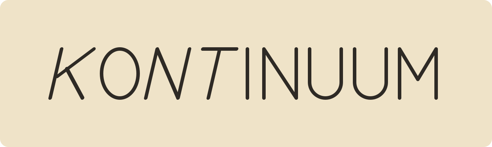

<p align="center">
  
</p>

# Kontinuum

Kontinuum is ambient and drone music that composes itself. Press play and a generative
**director** writes the music as it goes: it picks keys and chords, chooses which layers sound
in each section, moves the filters, the space and the density, and keeps changing for hours
without repeating itself. You can also play along with a MIDI keyboard or pads.

## What is in it

- **Seven layers:**
  - **drone:** long, low notes;
  - **pad:** slow chords;
  - **texture:** air and drops;
  - **bells:** sparse and distant FM bells, or a soft felt piano;
  - **percussion:** a pulse that comes in only now and then;
  - **choir:** synthesized voices that morph between vowels;
  - **modular:** Berlin-school sequences, low-pass-gate plucks, or a nylon guitar (plucked
    strings and slow strums).

  Each section, the director picks two to four of them and a timbre for each (seven pads,
  from PWM strings to a wavefolder; five drones, from a deep sine to a ladder filter), so the
  music never sounds like the same piece for long.
- **The director:** it composes in sections of a few chords and can change key, bring the pulse
  or the choir in and out, and drift through the Menu. Its automations are slow random walks,
  and you set how far they move with **Evolution**.
- **The Menu:** recipes that set the mood: *Early Mist*, *Deep Focus*, *Cathedral*, *Copper
  Rain*, *Wet Forest*, *Orbit*, *Dusk* and *Drift*.
- **Seeds:** the same seed and recipe always give the same piece.
- **Playing along:** three modes.
  - **Accompany:** the director follows the chords you play.
  - **Solo:** only you play.
  - **Relay:** the director rests while you play and takes over after a while without notes.
- **Beside the music:** nature under it (rain, a forest with birds, a fire, the sea), a
  **lo-fi** mode (a soft swung beat, a record's crackle, a darker sound) and **binaural**
  tones. All synthesized, nothing recorded.
- **The clock:** the recipe can follow the time of day, and the **sleep timer** (up to two
  hours) fades the music and the picture to silence.
- **The stage:** a full-screen picture of what every layer and the director are doing, made
  to be streamed (F11 toggles it). The sky follows your local time (dawn, day, dusk, night,
  with the sun and the moon); mountains over a lake that reflects the light; each recipe's
  landscape (fog, a forest, a ringed planet, arches of light, a far city); rain, snow,
  leaves, petals and fireflies with the weather and the season; the harmony wheel with the
  chord as a constellation; waves of light on new sections; the seed's own constellation;
  Lumo, the little lantern spirit; a slow camera; and, if you like, the whole stage seen
  through a cozy rainy window. Everything can be turned off in LIVE > Stage.
- **Go live:** stream the stage and the music to YouTube by yourself, without OBS: paste the
  stream key (YouTube Studio > Go live > Stream) in the LIVE window and press Go live. It
  reconnects by itself and keeps going with the window minimized. Also:
  - **other platforms** at the same time (Twitch, Kick, any RTMP server) and a **copy** of
    every stream on your computer;
  - a **schedule** (go live every day from 22:00 to 06:00, say);
  - the **texts for YouTube** (title, description with the replay's chapters, pinned comment,
    hashtags, tags) in English, Spanish or both, written from what plays;
  - a **thumbnail** made from the stage with big words, a 60-second upright **Short**, the
    last recording cut into **1, 3 and 8 hour** videos;
  - a **focus timer** (25/5) on the stage;
  - **vertical video** (9:16).

  It uses [ffmpeg](https://ffmpeg.org): the Windows download includes it; on macOS
  `brew install ffmpeg`, on Linux your package manager's.
- **The chat:** with a YouTube Data API key (free: console.cloud.google.com > a project >
  enable *YouTube Data API v3* > Credentials > API key) and the link of the live video,
  Kontinuum reads the chat. The audience votes for the next recipe (`!orbit`, `!dusk`… and
  `!1`, `!2`, `!3` in the polls), brings nature (`!nature rain`) or the lo-fi beat (`!lofi`),
  is welcomed on the stage, shines as one star per person watching, and milestones
  (subscribers, likes) are celebrated. **Moderation:** nothing viewers write is shown; only
  fixed commands act and only clean names appear; a message with an insult (built in, in
  English and Spanish, even disguised as `p.u.t@a`, plus your own words) makes the stage
  ignore its author; and names you list are always ignored. Use YouTube's own moderation too
  (held messages, blocked words, slow mode).
- **MIDI:** a keyboard plays the layer marked KEYS (Accompany, Solo or Relay), channel 10 or a
  pad controller plays the percussion, and MIDI learn ties your knobs and faders to the
  director's knobs and the layers' levels. The notes you play light up the stage.
- **Export and record:** the music of a recipe and seed as WAV, FLAC or Ogg (5 to 60 minutes),
  **stems** (one file per layer, to mix elsewhere), and **recording** what plays, with what you
  play on the keyboard.
- **My recipes:** save what plays (the recipe, the knobs, the sounds, the seed) under a name.
- **English or Spanish**, and a notice when a new version is out.

## Command line

```sh
knt menu                                         # the recipes
knt render -r 2 -s 7 -m 10 -o cathedral.flac     # 10 minutes of Cathedral, seed 7
knt render -r 1 -m 60 --ambience rain --lofi -o focus.ogg   # with rain and the lo-fi beat
knt play -r "deep focus"                         # play until Ctrl+C
```

## Building

Rust (see `rust-toolchain.toml`). On Linux, the ALSA headers too (`libasound2-dev`).

```sh
cargo run --release -p knt-ui        # the app
cargo run --release -p knt-cli -- menu
cargo test --workspace
```

## Roadmap

- publishing the title, description and thumbnail to YouTube directly (it needs a sign-in
  with Google);
- more scenery and timbres.

## License

Kontinuum is free software under the [GNU General Public License v3.0](LICENSE)
(GPL-3.0-only). See [NOTICE](NOTICE).
